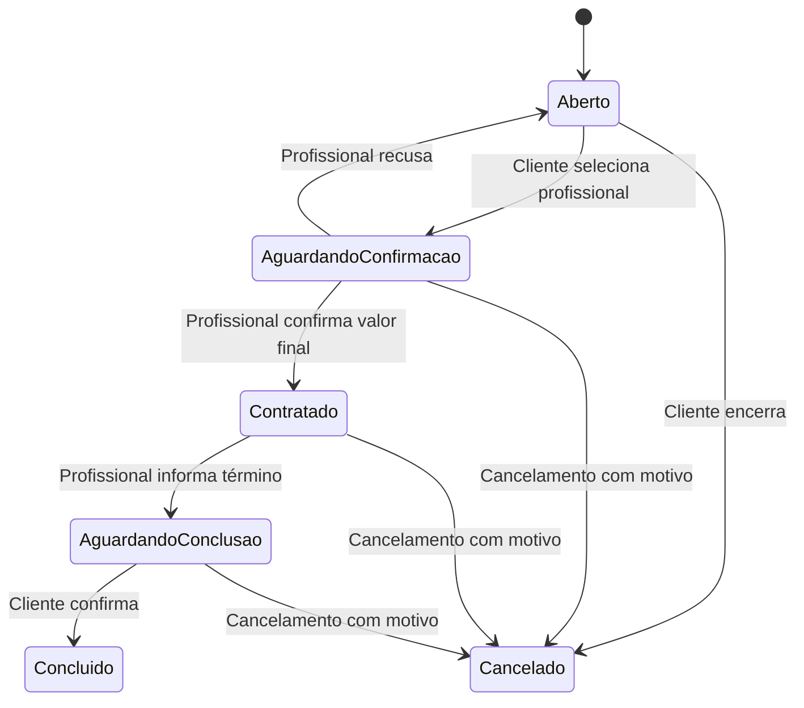

# Discovery e requisitos

## Contexto

Trabalho individual de um estudante do 4º semestre de ADS. Objetivo acadêmico: demonstrar um fluxo compreensível de publicação e contratação em Android, usando JavaScript e React Native. Entrega parcial em 26/10/2026 e final em 23/11/2026.

## Problema

Moradores de Fortaleza têm dificuldade para encontrar profissionais e conseguir orçamentos. Atualmente utilizam indicações, WhatsApp e redes sociais. O produto concentra oportunidades e propostas.

O discovery foi feito com o autor do projeto. Entrevistas com clientes e profissionais foram adiadas por decisão do autor. Os benefícios são hipóteses, ainda sem validação de campo.

## Públicos e valor

| Público | Necessidade | Benefício esperado |
| --- | --- | --- |
| Cliente | Encontrar profissionais e orçamentos | Publicar uma vez e receber propostas |
| Profissional | Encontrar oportunidades | Consultar pedidos e enviar preço e disponibilidade |

Uma conta pode assumir os dois papéis. Não é permitido enviar proposta no próprio pedido.

## Jornada acordada

1. Cliente publica título, categoria, descrição, bairro, fotos opcionais e necessidade de atendimento em até 24h.
2. Profissional envia proposta de preço fechado e mensagem. Não existe opção de visita para orçamento.
3. O envio autoriza compartilhar o telefone do profissional com aquele cliente após o aceite para conversar.
4. Cliente aceita conversar e autoriza compartilhar o próprio número. Ambos acessam o contato.
5. Negociação e pagamento são combinados diretamente, pelo WhatsApp.
6. Cliente escolhe um profissional. O profissional registra o valor final acordado e confirma a contratação.
7. Profissional informa a conclusão. Cliente confirma e pode avaliar.
8. As partes podem cancelar a contratação com motivo registrado.

Aceitar conversar não significa contratar. O cliente pode conversar com vários profissionais, mas contrata somente um por publicação. A indicação de 24h expressa necessidade, sem garantia de atendimento.

## Requisitos funcionais do MVP final

| ID | Requisito | Entrega parcial |
| --- | --- | --- |
| RF01 | Cadastro e login por e-mail e senha, com telefone | Planejado |
| RF02 | Perfil profissional com descrição, categorias e bairros | Planejado |
| RF03 | Publicar solicitação com campos obrigatórios e fotos opcionais | Parcial: sem fotos e sem persistência |
| RF04 | Consultar e filtrar serviços por categoria e bairro | Parcial: consulta sem filtros |
| RF05 | Enviar proposta com preço fechado e mensagem | Simulado |
| RF06 | Retirar proposta antes da contratação | Planejado |
| RF07 | Aceitar contato e liberar os números somente às partes | Planejado |
| RF08 | Selecionar profissional e confirmar valor final/contratação | Planejado |
| RF09 | Informar e confirmar conclusão | Planejado |
| RF10 | Avaliar com nota de 1 a 5 e comentário opcional | Planejado |
| RF11 | Encerrar pedido ou cancelar contratação com motivo | Planejado |

Login, filtros, regras de avaliação e perfil foram aceitos como propostas iniciais ao continuar o discovery. Devem ser revisados se houver exigência específica do professor.

## Regras de negócio

- Atuação inicial em Fortaleza, nas quatro categorias definidas.
- Bairro é público; endereço completo é combinado no WhatsApp.
- Uma proposta ativa por profissional em cada serviço é a simplificação adotada no protótipo.
- Proposta exige valor numérico positivo e mensagem.
- Telefones não podem constar em listas públicas; o consentimento é específico para o par cliente/profissional e serviço.
- Uma avaliação por serviço concluído, feita pelo cliente daquele serviço.
- Cancelamento não equivale a conclusão e não libera avaliação de serviço concluído.
- Na versão com banco, permissões e transições devem ser verificadas no servidor/banco, além das telas.

## Estados previstos

## Modelo de dados proposto

| Entidade | Campos principais |
| --- | --- |
| Usuário | id, nome, e-mail, telefone, descrição profissional, categorias, bairros, foto opcional |
| Serviço | id, clienteId, título, descrição, categoria, bairro, urgente24h, fotos, status, profissionalId, valorFinal, motivoCancelamento |
| Proposta | id, servicoId, profissionalId, valor, mensagem, status, autorização de contato do profissional, aceite de contato do cliente |
| Avaliação | id, servicoId, clienteId, profissionalId, nota, comentário |

Senhas ficam sob responsabilidade do provedor de autenticação; não pertencem aos registros públicos de usuário. Esta é uma modelagem proposta, ainda sem banco implementado.

## Critérios de aceite da versão final

- Dois usuários conseguem publicar e responder a um pedido sem perder dados ao reiniciar.
- Proposta no próprio pedido é bloqueada.
- Telefone permanece indisponível antes do aceite e para terceiros.
- Liberar contato mantém o pedido aberto; contratação exige confirmação do profissional escolhido.
- Somente um profissional pode ficar contratado por pedido.
- Somente as partes autorizadas conseguem atualizar contratação e conclusão.
- Avaliação só é criada pelo cliente após conclusão e não pode ser duplicada.
- Cancelamento exige motivo e impede novas contratações naquele pedido.

## Fora do escopo

Pagamento integrado, chat interno, mapas, rastreamento, garantia de execução, mediação de conflitos, verificação documental de profissionais e outras cidades. Não haverá promessa de profissionais verificados.

## Pendências e riscos

- Confirmar se o professor exige banco, autenticação ou formato específico de documentação.
- Escolher armazenamento e autenticação em uma etapa própria; não há tecnologia de backend definida.
- Confirmar o que acontece se o cliente discordar da conclusão; proposta inicial: manter pendente até alinhamento externo.
- Testar SDK e instalação no Android usado na apresentação.
- Fotos e autenticação aumentam o trabalho; implementar por etapas, sem esconder limitações da demonstração.
